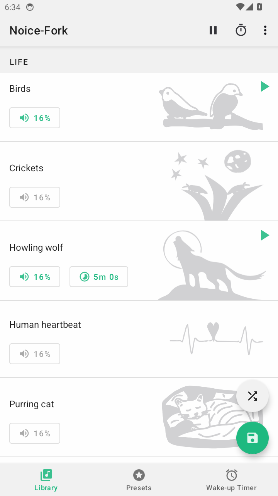
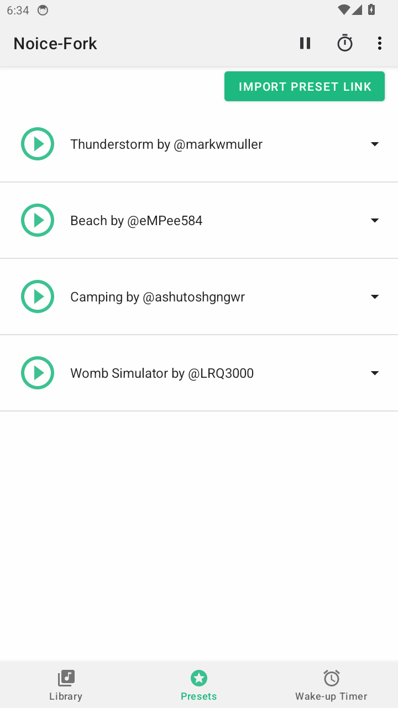

# Noice-Fork

[](https://github.com/LRQ3000/Noice-Fork/releases/latest)
[](https://github.com/LRQ3000/Noice-Fork/actions/workflows/debug-apk.yml)
[](LICENSE)

**Noice-Fork is a free, offline ambient sound mixer for Android phones and tablets.** Layer rain, wind, a crackling fire, or steady noise to make a soundscape for focus, relaxation, or bedtime. The sounds are bundled, so you can start listening on the first launch without a connection, an account, or a subscription.

<a href="https://github.com/LRQ3000/Noice-Fork/releases/latest"></a>

[Changelog](docs/CHANGELOG.md) · [Report an issue](https://github.com/LRQ3000/Noice-Fork/issues)

## Features

- 🔁 **Dual-sampling engine.** A signature feature of Noice V1 and Noice-Fork. For sounds such as Bonfire, the engine plays two short recordings of deliberately different lengths instead of looping a single track. The layers restart at different times, so the combined pattern takes longer to repeat and can sound less repetitive without a long recording.
- 🎚️ **Build your own soundscape.** Play several sounds at once and set each sound’s volume independently. Set how long occasional sounds like thunder can go between repeats.
- ⭐ **Start with a preset.** Try Thunderstorm, Beach, Camping, or [Womb Simulator](#womb-simulator) (to soothe the tiniest, loudest roommate). Generate a random mix by mood and intensity, or save your own.
- ⏱️ **Set a timer.** Stop playback after a set duration with **Sleep Timer**, or use **Wake-up Timer** to start a saved mix at a chosen time.
- 🎧 **Listen in the background.** Control playback from the Android media notification. Add preset shortcuts on supported launchers.
- 🔗 **Share or back up your mixes.** Send a link containing the recipe, not the recordings, or export your preset collection to a file. Noice V1 preset links are still importable.

### How dual sampling works

In an idealized example, two 40- and 45-second loops that start together line up again after six minutes. Each recording still repeats, but it overlaps with a different part of the other recording each time it restarts, until the loops line up again. That is the idea behind the [original dual-sampling proposal](https://github.com/trynoice/android-app/issues/62).

The perceptual effect is **less noticeable repetition in an auditory texture**. In [listening experiments on repeated sound textures](https://doi.org/10.1016/j.cognition.2025.106350), repetition was generally harder to detect as the repeating segment got longer. The study did not test Noice or establish that its repeats go unnoticed.

## Screenshots

  

## Download and install

Noice-Fork supports **Android 5.0 (Lollipop, API 21) and later** on both phones and tablets. The same sound library, presets, and timers are available on either.

1. On your Android device, open the [latest GitHub release](https://github.com/LRQ3000/Noice-Fork/releases/latest) and download the `.apk` under **Assets**, not the source archive.
2. Open the downloaded file and install **Noice-Fork**. If prompted, allow installs from that browser or file manager (on Android 5–7, look for **Settings → Security → Unknown sources**). Turn that permission off again after installing.
3. Open the app and choose a sound in **Library** or play a mix in **Presets**.

The current release APK is debug-signed and is not distributed through Google Play or F-Droid. For development snapshots, sign in to GitHub, open [Actions → Debug APK](https://github.com/LRQ3000/Noice-Fork/actions/workflows/debug-apk.yml), and download the `Noice-Fork-debug` artifact from a successful `main` run. Unzip it to get the APK.

**Updating from an older APK?** Android cannot install one signed with a different key over your existing build. Before uninstalling, back up your mixes under **Settings → Presets → Export to a file**. After reinstalling, use **Import from a file** to restore them. File import replaces the current preset collection.

## Quick start

1. **Play a ready-made mix:** open **Presets** and tap the play button beside **Thunderstorm** or **Beach**.
2. **Make your own:** open **Library**, then tap sounds to turn them on or off. Tap the percentage beside a playing sound to adjust its volume. Use **Save Preset** (the save icon) while the new mix is playing to name and save it.
3. **Set a timer:** open **Sleep Timer** and add time to stop playback after a delay. To start playback at a specific time, open **Wake-up Timer**, choose a preset and time, then tap **Schedule**.
4. **Send or import a mix:** in **Presets**, open the mix’s menu and choose **Share**. To use a shared mix, copy the entire link, including any `#` fragment, then open **Presets → Import preset link** and paste it. See the [preset guide](docs/PRESETS.md).

## Womb Simulator

This built-in preset follows [@LRQ3000’s original six-layer recipe for Noice V1](https://github.com/trynoice/android-app/issues/1055). Brown noise, soft wind, wind in palm trees, a water stream, and the hum of an electric car create a low, steady backdrop. The moving train adds a heartbeat-like rhythm. The idea is that the steady background may make sudden household noises less noticeable. This is a designed soundscape, not a recording from inside the womb or a proven infant sleep aid.

**What the research found:** [Parga et al. (2018)](https://doi.org/10.1371/journal.pone.0197045) found that low frequencies predominated in recordings made with stethoscopes placed on pregnant participants’ abdomens. Those recordings do not directly measure what a fetus hears. In a [small randomized trial of 40 newborns](https://doi.org/10.1136/adc.65.1.135), 16 of 20 fell asleep within five minutes with white noise, compared with 5 of 20 without it. That trial did not test brown noise, the train rhythm, or this preset, and does not establish that the mix helps babies fall or stay asleep.

**Hearing safety:** If playing sounds near an infant, follow the [American Academy of Pediatrics’ guidance](https://www.aap.org/en/patient-care/environmental-health/promoting-healthy-environments-for-children/noise/): keep the device as far from the infant as possible, use the lowest practical volume, and limit playback time. The app’s sliders show relative volume, not the sound level at the infant’s ear.

## Privacy

The app does not request Internet access and includes no ads or analytics. Presets and settings are stored on the device; Android may back them up according to your system settings. See the [privacy policy](docs/PRIVACY.md).

## About the fork

Noice-Fork independently maintains the offline mixer and [dual-sampling engine](#how-dual-sampling-works) from [Noice v1.3.3](https://github.com/trynoice/android-app/releases/tag/1.3.3). [Noice V2](https://trynoice.com/news/v2-announcement) took a different approach with longer, streamed recordings; this fork does not maintain V2.

## Authorship

- **Original Noice:** [Ashutosh Gangwar (@ashutoshgngwr)](https://github.com/ashutoshgngwr) and the [original Noice contributors](docs/CONTRIBUTORS.md).
- **Fork maintainer:** [Stephen Karl Larroque (@LRQ3000)](https://github.com/LRQ3000).
- **Built-in presets:** Thunderstorm by [@markwmuller](https://github.com/markwmuller), Beach by [@eMPee584](https://github.com/eMPee584), Camping by [@ashutoshgngwr](https://github.com/ashutoshgngwr), and [Womb Simulator](https://github.com/trynoice/android-app/issues/1055) by [@LRQ3000](https://github.com/LRQ3000).

## License

The app source code is licensed under the [GNU General Public License v3.0 only (GPL-3.0-only)](LICENSE). Bundled audio has separate terms: clips are public domain or available under [CC0 1.0](https://creativecommons.org/publicdomain/zero/1.0/), [CC BY 3.0](https://creativecommons.org/licenses/by/3.0/), or [CC BY 4.0](https://creativecommons.org/licenses/by/4.0/). The [soundbank manifest](docs/audio-sources.json) lists each recording’s creator, source, license, edits, and SHA-256. Some clips were replaced for redistribution; old presets keep their settings, but those layers can sound different.

## Build and contribute

With JDK 11 and Android SDK 30, run the commands below from the repository root. On Windows, use `.\gradlew.bat` instead of `./gradlew`. The free variant does not require Google services configuration.

```sh
./gradlew :app:testFreeDebugUnitTest :app:assembleFreeDebug
python3 scripts/verify_audio.py --apk app/build/outputs/apk/free/debug/app-free-debug.apk
```

Use the [issue tracker](https://github.com/LRQ3000/Noice-Fork/issues) to report a bug, request a feature, or share a preset. See the [contribution guide](docs/CONTRIBUTING.md) and the [F-Droid packaging draft](docs/fdroid/SUBMISSION.md).
