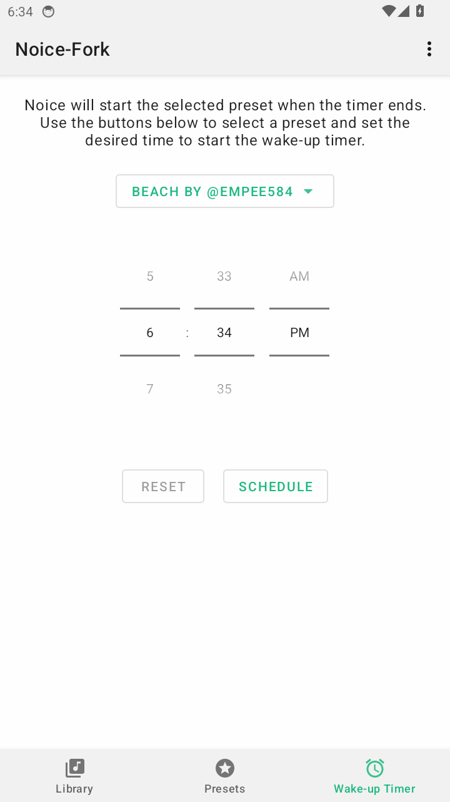

# Noice-Fork

[](https://github.com/LRQ3000/Noice-Fork/releases/latest)
[](https://github.com/LRQ3000/Noice-Fork/actions/workflows/debug-apk.yml)
[](LICENSE)

**Noice-Fork is a free, offline ambient sound mixer for Android phones and tablets.** Layer rain, wind, a crackling fire, or steady noise to make a soundscape for focus, relaxation, or bedtime. The sounds are bundled, so you can start listening on the first launch without a connection, an account, or a subscription.

**[Download the APK from GitHub Releases](https://github.com/LRQ3000/Noice-Fork/releases/latest)** · [Changelog](docs/CHANGELOG.md) · [Report an issue](https://github.com/LRQ3000/Noice-Fork/issues)

## Features

- **Build your own soundscape.** Play several sounds at once and set each sound’s volume independently. Set how long occasional sounds like thunder can go between repeats.
- **Start with a preset.** Try Thunderstorm, Beach, Camping, or Womb Simulator, generate a random mix by mood and intensity, or save your own.
- **Set a timer.** Stop playback after a set duration with **Sleep Timer**, or use **Wake-up Timer** to start a saved mix at a chosen time.
- **Listen in the background.** Control playback from the Android media notification. Add preset shortcuts on supported launchers.
- **Share or back up your mixes.** Send a link containing the recipe, not the recordings, or export your preset collection to a file. Noice V1 preset links are still importable.

## Screenshots

  

## Download and install

Noice-Fork supports **Android 5.0 (Lollipop, API 21) and later** on both phones and tablets. The same sound library, presets, and timers are available on either.

1. On your Android device, open the [latest GitHub release](https://github.com/LRQ3000/Noice-Fork/releases/latest) and download the `.apk` under **Assets**, not the source archive.
2. Open the downloaded file and install **Noice-Fork**. If prompted, allow installs from that browser or file manager (on Android 5–7, look for **Settings → Security → Unknown sources**). Turn that permission off again after installing.
3. Open the app and choose a sound in **Library** or play a mix in **Presets**.

The current release APK is debug-signed and is not distributed through Google Play or F-Droid. For development snapshots, sign in to GitHub, open [Actions → Debug APK](https://github.com/LRQ3000/Noice-Fork/actions/workflows/debug-apk.yml), and download the `Noice-Fork-debug` artifact from a successful `main` run. Unzip it to get the APK.

**Updating from an older APK?** Android cannot install one signed with a different key over your existing build. Before uninstalling, back up your mixes under **Settings → Presets → Export to a file**. After reinstalling, use **Import from a file** to restore them. File import replaces the current preset collection.

## Quick start

1. **Play a ready-made mix:** open **Presets** and tap the play button beside **Thunderstorm** or **Beach**.
2. **Make your own:** open **Library**, then tap sounds to turn them on or off. Tap the percentage beside a playing sound to adjust its volume. Use **Save Preset** (the save icon) while the new mix is playing to name and save it.
3. **Set a timer:** open **Sleep Timer** and add time to stop playback after a delay. To start playback at a specific time, open **Wake-up Timer**, choose a preset and time, then tap **Schedule**.
4. **Send or import a mix:** in **Presets**, open the mix’s menu and choose **Share**. To use a shared mix, copy the entire link, including any `#` fragment, then open **Presets → Import preset link** and paste it. See the [preset guide](docs/PRESETS.md).

**About Womb Simulator:** This is a soundscape, not a womb recording or a proven infant sleep aid. If playing sounds near an infant, follow the [American Academy of Pediatrics’ hearing-safety guidance](https://www.aap.org/en/patient-care/environmental-health/promoting-healthy-environments-for-children/noise/): keep the device far away, use the lowest practical volume, and limit playback time. The app’s sliders are relative levels, not decibel measurements. See the [preset notes](docs/PRESETS.md#womb-simulator).

## Privacy

The app does not request Internet access and includes no ads or analytics. Presets and settings are stored on the device; Android may back them up according to your system settings. See the [privacy policy](docs/PRIVACY.md).

## About the fork

Noice-Fork independently maintains the offline mixer from [Noice v1.3.3](https://github.com/trynoice/android-app/releases/tag/1.3.3). For some sounds, it plays two short recordings of different lengths in parallel: the layers still repeat, but their loop boundaries usually do not line up, so the combined sound can feel longer without large recordings. [Noice V2](https://trynoice.com/news/v2-announcement) took a different approach with longer, streamed recordings; this fork does not maintain V2.

## Authorship

- **Original Noice:** [Ashutosh Gangwar (@ashutoshgngwr)](https://github.com/ashutoshgngwr) and the [original Noice contributors](docs/CONTRIBUTORS.md).
- **Fork maintainer:** [Stephen Karl Larroque (@LRQ3000)](https://github.com/LRQ3000).
- **Built-in presets:** Thunderstorm by [@markwmuller](https://github.com/markwmuller), Beach by [@eMPee584](https://github.com/eMPee584), Camping by [@ashutoshgngwr](https://github.com/ashutoshgngwr), and [Womb Simulator](https://github.com/trynoice/android-app/issues/1055) by [@LRQ3000](https://github.com/LRQ3000).

## License

The app source code is licensed under the [GNU General Public License v3.0 only (GPL-3.0-only)](LICENSE). Bundled audio has separate terms: clips are public domain or available under [CC0 1.0](https://creativecommons.org/publicdomain/zero/1.0/), [CC BY 3.0](https://creativecommons.org/licenses/by/3.0/), or [CC BY 4.0](https://creativecommons.org/licenses/by/4.0/). The [soundbank manifest](docs/audio-sources.json) lists each recording’s creator, source, license, edits, and SHA-256. Some clips were replaced for redistribution; old presets keep their settings, but those layers can sound different.

## Build and contribute

With JDK 11 and Android SDK 30, run the commands below from the repository root. On Windows, use `.\gradlew.bat` instead of `./gradlew`. The free variant does not require Google services configuration.

```sh
./gradlew :app:testFreeDebugUnitTest :app:assembleFreeDebug
python3 scripts/verify_audio.py --apk app/build/outputs/apk/free/debug/app-free-debug.apk
```

Use the [issue tracker](https://github.com/LRQ3000/Noice-Fork/issues) to report a bug, request a feature, or share a preset. See the [contribution guide](docs/CONTRIBUTING.md) and the [F-Droid packaging draft](docs/fdroid/SUBMISSION.md).
